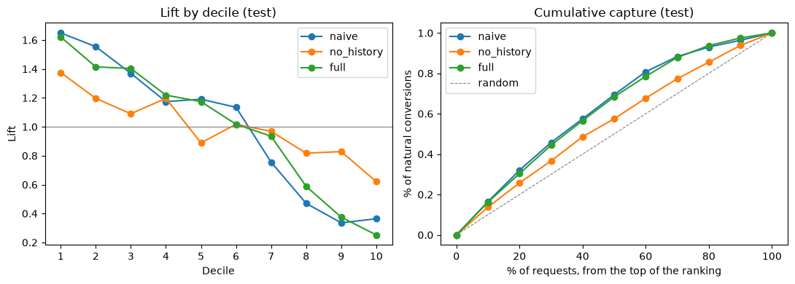
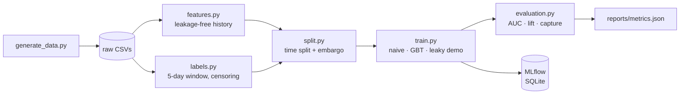

# ML Batch Prioritization System

[](https://github.com/paulrodriguezd/ml-batch-prioritization-system/actions/workflows/tests.yml)

A batch machine learning system in **PySpark** that ranks each day's quote requests by the probability of
converting **on their own within 5 days**, so a sales team with limited time can skip them and focus on the rest.

It runs end to end on a laptop with synthetic data, tracks every model in **MLflow**, and is built around three
things that usually go wrong in this kind of project: information leaking from the future, labels that are not
yet known, and models that are never compared with a simple rule.

Inspired by a production system; the domain, data and code here are entirely synthetic and rewritten from scratch.

## Problem definition

| | Definition |
|---|---|
| **Unit** | One quote request from a B2B customer. |
| **Label** | 1 if the request converted within 5 days of being made, else 0. |
| **Population** | Requests whose 5-day window had closed by the extraction date (2026-01-01). Recent requests are *unknown*, not 0. |
| **History features** | Only conversions that happened **strictly before** the request being scored. |
| **Split** | Train until 2025-06, validation 2025-07 to 2025-09, test 2025-10 to 2025-12, with a 5-day gap before each boundary so no label crosses into the next period. |
| **Metrics** | ROC/PR AUC, and for the top 10% / 20% of the ranking: precision and **capture** (share of *all* natural conversions it contains). |

## Results

Test period: 7,106 requests, 25.2% convert on their own within 5 days.

| Model | ROC-AUC valid | ROC-AUC test | PR-AUC test | Top 10% precision | Top 10% capture | Top 20% capture |
|---|---:|---:|---:|---:|---:|---:|
| **Naive rule**: customer's historical conversion rate | 0.666 | **0.674** | 0.368 | 41.5% | 16.5% | 32.0% |
| GBT, request attributes only | 0.559 | 0.575 | 0.302 | 34.6% | 13.8% | 25.7% |
| **GBT**, request attributes + leakage-free history | **0.678** | 0.667 | 0.361 | 40.8% | 16.2% | 30.4% |
| GBT with the original *leaky* history (demo only) | 0.675 | 0.669 | 0.357 | 39.0% | 15.5% | 30.3% |



**What this says**

- **The customer's history carries the signal.** Without it, the model is clearly weaker.
- **The gradient-boosted model does not beat the naive rule.** They rank requests about equally well, so the rule
  is what should be deployed: cheaper, explainable and as good. This is why every model is compared against a
  naive baseline first.
- **The leakage fix barely moves the metrics on this data, and is still required.** The original logic counted
  conversions that had not happened yet in about 15% of requests. Here that does not inflate the scores, but on
  real data a leaky model can look better in evaluation and then degrade in production. Tests guarantee the model
  only uses information available at scoring time.
- Differences of a few thousandths of AUC are noise; the stable result is *naive ≈ full > no history*.

Full walkthrough with outputs: [`notebooks/model_training_pipeline.ipynb`](notebooks/model_training_pipeline.ipynb).

## How it works



| Module | Responsibility |
|---|---|
| `scripts/generate_data.py` | Deterministic synthetic data (seed 42). Writes only what would be known on the extraction date. |
| `src/batch_prioritization/features.py` | History per request via a self-join on earlier requests; a conversion counts only if it happened before the request. |
| `src/batch_prioritization/labels.py` | Label within 5 days; requests whose window has not closed get no label. |
| `src/batch_prioritization/split.py` | Time split with embargo; UTC cut-offs independent of the machine's time zone. |
| `src/batch_prioritization/model.py` | Spark ML GBT pipeline; missing values filled with fixed constants, nothing learned outside train. |
| `src/batch_prioritization/evaluation.py` | Ranking metrics with reproducible tie-breaking. |
| `src/batch_prioritization/train.py` | Trains every model on the same splits, logs to MLflow, writes `reports/metrics.json`. |
| `src/batch_prioritization/leaky.py` | The original leaky logic, kept **only** to measure its effect. |

## Run it

Requirements: Java 17 and Python 3.12.

```bash
python -m venv .venv && source .venv/bin/activate
pip install -r requirements.txt
python scripts/generate_data.py                      # data/raw/*.csv
pytest                                               # 18 tests
PYTHONPATH=src python -m batch_prioritization.train  # ~2 minutes, prints the results table
```

On macOS, Java 17 can be installed with `brew install openjdk@17` and used by setting
`JAVA_HOME=$(brew --prefix openjdk@17)/libexec/openjdk.jdk/Contents/Home`.

MLflow runs are stored locally in `mlflow.db` (artifacts in `mlruns/`). To browse them:
`mlflow ui --backend-store-uri sqlite:///mlflow.db` (needs the full `mlflow` package).

## Tests

| What | How |
|---|---|
| No future information in history features | Hand-built cases (conversion after, before and at the same second as the request; other customers; ties) and an independent recomputation in plain Python on 50 random requests. Deliberately breaking the rule makes them fail. |
| Label window and censoring | Exact 5-day boundary, conversions before the request, windows still open on the extraction date. |
| Time split | Embargo before each boundary; cut-offs unchanged when the machine runs in another time zone. |
| Metrics | Capture vs precision, lift on a perfect ranking, reproducibility with ties, no conversions. |
| Baselines | Naive rule uses the training base rate for first-time customers; leaky demo really does count future conversions. |

More detail: [docs/method.md](docs/method.md) · [docs/limitations.md](docs/limitations.md).

## License

[MIT](LICENSE)
